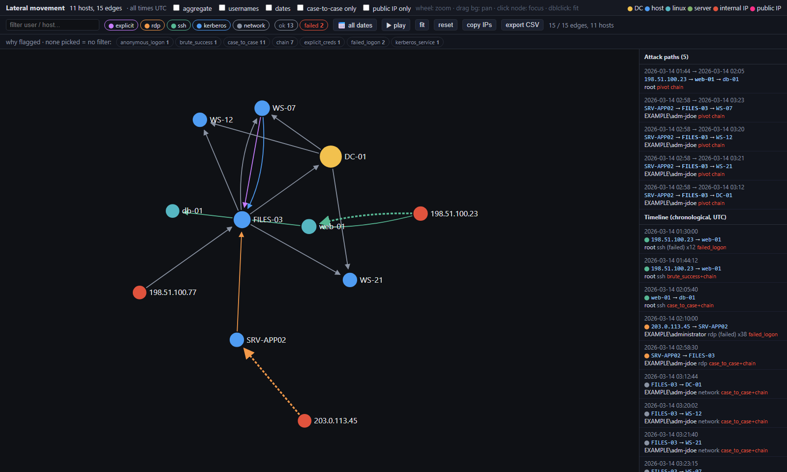
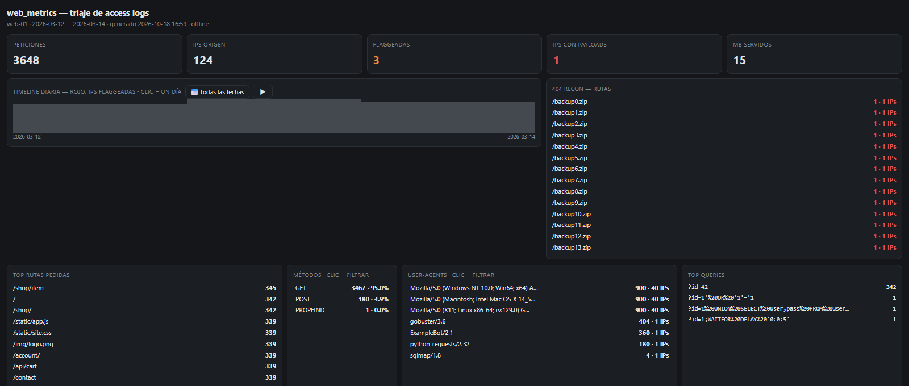
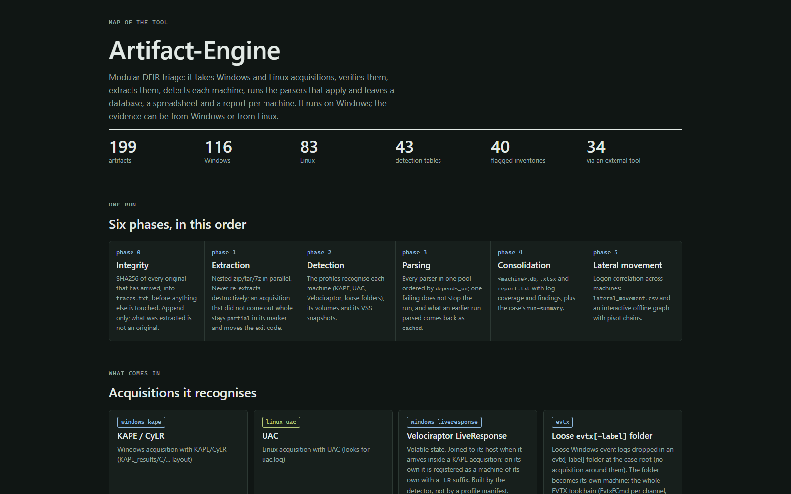

<p align="center">
  
</p>

<h1 align="center">Artifact-Engine</h1>

<p align="center"><i>DFIR triage &#183; parse &#183; detect &#183; connect</i></p>

<p align="center">
  <a href="LICENSE"></a>
  <a href="pyproject.toml"></a>
  
  
</p>

Modular DFIR triage engine. It extracts workstation/server acquisitions
(**KAPE** and **Velociraptor live response** on Windows, **UAC** on Linux — plus
loose web-server / FortiGate / Windows event-log drops), detects the system type,
runs **197 forensic parsers** (115 for disk and log evidence, 82 for memory images)
in parallel and consolidates the results into a `.db`
(SQLite) and a `.xlsx` (Excel) per machine for review, with a detection layer
(YARA, Sigma, Hayabusa, LOLBAS/LOLDrivers/RMM, persistence scans) and a
cross-machine lateral-movement graph on top.

Successor to CyberCrusader, redesigned to be **fast, parallel and easy to
extend**: parsing tools are declared in **YAML**, not in code.

See [ARCHITECTURE.md](docs/ARCHITECTURE.md) for the internals (pipeline stages,
module layout, how detections and the lateral-movement graph are built), and
[atlas.html](docs/atlas.html) for the map of every parser — where each one reads from,
what it gets, which folder its tables land in and whether it produces alerts. That page
is **generated from the manifests** (`python -m artifact_engine.core.atlas`) and a test
compares it against them, so a parser added without regenerating it turns CI red: the
map cannot describe a different tool from the one that ships.

<p align="center">
  
  <br>
  <sub>The cross-machine lateral-movement graph (<code>lateral_movement.html</code>): who
  authenticated where and how (RDP, SMB, SSH, Kerberos, explicit credentials), the brute
  force that worked, and every pivot chain in the panel beside it, in time order.
  Synthetic case built by <code>docs/demo/make_images.py</code>.</sub>
</p>

## Contents

- [Pipeline](#pipeline)
- [Installation](#installation)
- [Usage](#usage)
- [MCP server](#mcp-server)
- [Configuration](#configuration)
- [How to add a parsing tool](#how-to-add-a-parsing-tool)
- [Detections](#detections)
- [Example outputs](#example-outputs)
- [Output layout](#output-layout)
- [Reporting a bug](#reporting-a-bug)
- [Contributing and security](#contributing-and-security)

## Pipeline

```
parent folder with .zip / .tar.gz
   |
   v
[-] Arrival     -> a delivered archive is opened only once it has arrived (.sha256 seal, or settle_seconds)
[0] Integrity   -> traces.txt + traces.csv  (SHA256 of the originals, BEFORE touching anything)
[1] Extraction  -> recursive (tar.gz in one pass, nested, anti zip-bomb) + containers inside loose drops
[2] Detection   -> profile/OS per machine (profiles/*.yaml)
[3] Parsing     -> parsers (parsers/*.yaml) in parallel, respecting dependencies
[4] Consolidation -> <machine>.db + <machine>.xlsx + report.txt (informative sheet)
[5] Lateral movement -> lateral_movement.csv + .html (cross-machine logon graph)
```

## Installation

```sh
git clone https://github.com/MarcBernaldo/Artifact-Engine.git
cd Artifact-Engine
pip install -e .
aeng setup            # downloads binaries + offline assets, prepares the config
```

**The editable install (`-e`) is the intended deployment, not a developer
shortcut.** `aeng update` keeps the tool current by fast-forwarding this git
checkout, so the clone *is* the installation — a plain `pip install .` would copy
the code somewhere else and leave self-update with nothing to update. It also
means a source edit is live immediately, with no reinstall.

Add `[dev]` only to run the test suite (`pip install -e ".[dev]"` — pulls pytest,
ruff and openpyxl). An analyst running cases does not need them.

`setup` fetches the external tools (EZ Tools, hayabusa, SIDR, …) and
the offline enrichment assets: db-ip country/ASN databases + the Tor exit list
(IP origin columns), the YARA signature-base ruleset, and the community detection
lists (mthcht/awesome-lists) that name the tool behind a service or a scheduled
task. Everything is best-effort — a missing asset degrades gracefully (e.g.
country shows `?`, and a parser that has no threat list keeps its own detectors
and loses only the attribution).

If the `aeng` script is not on PATH, use `python -m artifact_engine` instead.

### Keeping it current

```sh
aeng update --check   # what is out of date; changes nothing
aeng update           # engine + detection rules + lookup databases
```

`setup` fills in what is **missing** and leaves the rest alone, so it will never
pick up a new YARA rule or a new hayabusa release. That is what `update` is for:

| What | How it is decided |
|---|---|
| **The engine** | Fast-forwards the git checkout to `origin`. Refuses — and changes nothing — on uncommitted work, a detached HEAD, or local commits that are not on origin. The running process keeps the old code in memory, so re-run `aeng` afterwards. |
| **signature-base YARA** | Re-synced every time (there is no version to compare). A rule upstream **withdrew is deleted here too** — rules are usually retired for firing on benign files, so a leftover copy keeps producing the exact false positive upstream removed. Rules you drop in that folder yourself are never touched. |
| **hayabusa** | Compared by version first, downloaded only if the release actually moved. It bundles a Sigma rule set, and its retired rules are purged the same way. Hayabusa's `config/` is left alone — that is what you tune. |
| **db-ip + Tor** | db-ip re-cuts monthly, so a refresh inside the same month is skipped instead of re-fetching identical bytes. The Tor exit list is re-read every time. |
| **Threat lists** (awesome-lists) | Re-fetched every time and reported by whether the bytes actually moved. Fetched rather than bundled on purpose: a frozen copy of a threat list ages into a false sense of coverage. |
| **LOTTunnels** | Re-downloaded every time and turned into `assets/lottunnels/tunnels.yaml`; reported `updated` only when that list changed. Its licence keeps it out of the repository, so this is the only way it arrives. |
| **Other parser binaries** | Only with `--tools`: EZ Tools ship from rolling "latest" URLs with no version to compare, so knowing whether they moved means downloading hundreds of MB. |
| **The interpreter** | Reported, never changed. On **Python 3.10 for Windows** it is flagged `at risk` and counted as pending: that interpreter ends a *run* with no error at all (see below), and calling every rule current while sitting on it would be a clean bill of health for the wrong patient. |

The run reports `updated` only when bytes actually changed, and rewrites
`tools.lock.json` so the sha256 of every binary that produced your outputs stays
on record. Do not run it while a case is being processed — the log of a run
should name one build, not two.

### Windows right-click integration

Double-click **`INSTALL.bat`** to add an *"Artifact-Engine"* entry, with the
tool's icon, to the folder right-click menu (registered for the current user, **no admin
required**). Right-click the parent folder holding the acquisitions and pick it
to run `aeng run -p "<that folder>"` in a console that stays open.

On **Windows 11** the entry lives under **"Show more options"** (Shift+F10), as
do all registry-based context-menu verbs. Run **`UNINSTALL.bat`** to remove it.
Equivalent commands: `aeng install-menu` / `aeng uninstall-menu`.

## Usage

```sh
aeng run -p "C:\path\to\the\evidence"     # parent folder with the .zip / .tar.gz
aeng lateral -p "C:\path\to\the\evidence" # rebuild only the lateral-movement graph
aeng sweep -p "C:\path\to\the\evidence" -q 10.0.0.5 -q bad.exe
aeng sweep -p "C:\path\to\the\evidence" --ioc-file iocs.txt --csv sweep.csv
aeng sweep -p "C:\path\to\the\evidence" -q bad.example.com --memory
aeng list-parsers
aeng list-profiles
```

`sweep` asks the whole case for something one machine taught you — an address, an
account, a hash, a filename — reading each machine's consolidated `.db` without
re-parsing anything. Cases are worked machine by machine, and going back over the
ones already finished every time the case learns something is the part a person
does badly; by machine seven nobody re-checks machine two.

An IOC list from a partner arrives as twenty values, not one, so `--ioc-file`
reads them from a file -- one per line, tolerating the way people actually paste
a spreadsheet column (surrounding quotes, a trailing comma, `#` header lines).
It combines with `-q`, and duplicates are dropped case-insensitively because the
search is. `--csv` writes the **whole sweep**, not just the hits: the values that
matched nothing (which is most of an IOC list, and is itself the result), the
machines that could not be opened, and the rows held back as the collection's own
copy. A file of hits alone cannot support *"we checked these IOCs across these
machines"* months later.

When the operator pointed the collector at the disk it was collecting, the `.db`
holds every artifact twice — once where it lives, once under the output tree — and
a search returns the real hit next to its duplicate. Those rows are dropped by
default and the number dropped is **always reported**; `--include-collection`
searches them anyway. The tree is identified by shape (a directory whose children
are the volume's own root), and `Windows.old` is deliberately not one of them: an
in-place upgrade leaves the same shape and what it holds is the host before the
upgrade.

It reports **which machines it could not search** separately from the hits, and
exits `2` when any were skipped. "No hits" over a case where a database was locked
or corrupt is not a statement about the case, and a script chaining off it has to
be able to tell. Matching is on value boundaries: `10.0.0.5` does not match
`10.0.0.50`, which is a different host.

`--memory` (v0.7.108) also reads every memory image in the case byte by byte,
as ASCII/UTF-8 and UTF-16LE, ignoring the case of ASCII letters: a URL in a browser's
heap, a typed password, the command line of a process that already exited --
text no Volatility plugin turned into a table. A hit is an offset into the image
with the text around it (table `memory_image`, column `ascii @0x...` or
`utf16le @0x...`), a lead to open in a hex viewer, not a statement about which
process held it. The same value boundaries apply (`jdoe` is not a hit inside
`jdoe2` or `jdoeé`; only Latin letters count as continuing a name, since
binary bytes beside a UTF-16 string often decode to a CJK one). The first 100 hits of a value
per image are listed and the rest counted (`unlisted` rows in `--csv`). The image
is read by up to eight processes; measured, about 45 GB of images in five minutes,
bound by the disk. It does not see pages the image does not hold (paged out, or
kept compressed by Windows), so "no hits" in memory is weaker than in a table.
An image that could not be read counts as a machine not searched, and the
sweep says how many images it read -- and warns when it found none.

**Exit codes**: `0` clean · `1` the command could not run at all · `130` interrupted ·
**`2` the command ran and its answer is incomplete** — for `run` that means a parser
errored, an acquisition did not extract whole *or* has not finished arriving, a
machine's outputs were never built, no machine was detected at all, or the run's own
summary could not be written (all six named in `run-summary.{txt,json}`),
for `sweep` that a machine could not be searched. Not a failure, and not a clean result
either. Until v0.7.15 a run printed its parser errors and still exited `0`, so
anything chained after it could not tell. Since v0.7.78 that verdict is decided in
exactly one place — the `status` field of `run-summary.json`, which also carries a
`schema_version`, the engine build, and the run's start/end as ISO-8601 UTC — and the
exit code is derived from it rather than computed a second time beside it. The one way
the two can still differ is a summary that could not be written at all, and that case
is covered by calling the run incomplete: better a `2` over a file that is missing or
stale than a `0` that agrees with nothing.

A truncated archive is the one worth knowing about, because it is the one that
leaves no trace of itself. Nothing errors: the parsers whose artifacts came out
before the cut run normally, and the ones whose input was cut out of the archive
find nothing, self-gate, and land in `skipped`, beside every artifact the machine's
distro genuinely lacks. The run then ends `OK 2 | skipped 37 | errors 0`, which is
what a clean triage of a quiet host looks like. Since v0.7.20 the run names those archives at the end, writes
them into `run-summary.{txt,json}`, and exits `2` — and because the verdict is stored
in the extraction marker, a later run over the same case says it again.

Not every complaint is that claim, and since v0.7.86 the difference is read from the
message rather than from the archiver's exit code. 7-Zip calls it a fatal error when
a member grew between being listed and being read — which is what a file being
written looks like, and on a live host something always is: the endpoint agent's
`.lck`, the registry's `DEFAULT.LOG1`, OneDrive's `.db-wal`. Those acquisitions
extracted **whole**, so they are listed separately as holding a member that is not a
faithful copy (`damaged_acquisitions`) and they do **not** make the run `incomplete`
or change the exit code. Measured on three real cases: eight of the eighteen
acquisitions the previous version reported as not whole were exactly this, and one
whole case was `incomplete` on nothing else. They are still reported, because the two
failures are opposites — a hole is silent, while a parser over a damaged member reads
it, succeeds, and writes a table with nothing in it saying the bytes were wrong.

Options: `--force` re-parses even if output already exists **and** rebuilds every
consolidation output; `-v` is verbose.

Both phases are cached, on the same principle: a parser reports `cached` when it
already ran, its manifest and code are unchanged, and nothing it reads
(`depends_on`) has run again since (v0.7.96), nor any list under `assets/` its
code names (v0.7.160: edit `web_suspicious.txt` and the next run re-runs
`web_sigma`, no `--force`); and a machine's `.db`/`.xlsx`
are skipped when
every CSV and JSON feeding them still hashes to what produced them (content, not
size and mtime — a rewrite to the same length would otherwise leave you reading a
database that silently does not contain it). A deleted output rebuilds regardless
of the marker. The run says which units it skipped and how many inputs it checked.

`cached` is its own status and not `skipped`, because they answer different
questions: `skipped` means this machine has no such artifact, `cached` means an
earlier run already parsed it and the tables are on disk. A cached parser counts
as done in the summary — with its own number beside it, so what *this* run did is
still readable.

### Loose log drops (no acquisition needed)

Logs that arrive on their own (a hosting export, a firewall export, a colleague
sending you a host's event logs) can be dropped in a folder named **`<kind>`** or
**`<kind>-<label>`** at the case root; each folder becomes its own machine with
its own `.db`/`.xlsx`. The folder NAME is the whole contract — there is no content
sniffing — and zipped exports inside are unpacked automatically:

```
C:\Cases\my-case\
  uac-server1-...\              <- normal acquisition
  weblogs-www.client.com\       <- Apache/nginx access logs (any file names,
    EXPORT_2026.zip                 rotations and zipped exports included)
  fortigate-fw-edge\            <- FortiGate/FortiOS key=value logs
  evtx-dc01\                    <- loose Windows event logs
    Security.evtx                   keep the canonical channel names
    rdp\Microsoft-Windows-TerminalServices-...%4Operational.evtx
```

| Kind | What runs on it |
|---|---|
| `weblogs` | Full request timeline, the SigmaHQ webserver ruleset plus your `web_suspicious.txt`, and audit aggregations in the interactive `web_metrics.html`. |
| `fortigate` | One flagged traffic/event timeline from FortiOS `key=value` logs (raw syslog or a FortiAnalyzer CSV export). |
| `evtx` | The **whole Windows event-log toolchain**, unchanged: EvtxECmd once per channel and Hayabusa. |

`evtx` is the one drop that is a **host**, not just a pile of logs: event logs are
logon evidence, so once parsed the machine is renamed from the folder to the host
its events actually name (their `Computer` field) and it joins the cross-machine
**lateral-movement graph** on that host's node, like any acquired machine.

Two things to know about it. Keep the **canonical channel file names**
(`Security.evtx`, `Microsoft-Windows-Sysmon%4Operational.evtx`, …): EvtxECmd picks
its channel by name, while Hayabusa sniffs content and reads
renamed files too. And use **one folder per host** — two logs sharing a basename
collide, so the first wins and the rest are reported rather than overwritten (and,
being unstaged, they stay exactly where you put them).

The logs are **hard-linked** into the layout the toolchain expects and then the
original path in the drop root is removed, so the folder ends up holding each event
log exactly once — under `<drop>\Windows\System32\winevt\Logs\`. Nothing is lost:
a hard link is a second *name* for one set of bytes, so dropping the first name
frees a duplicate listing, not data (total size is unchanged). An original is only
ever removed once its bytes are confirmed at the staged path.

Full detail: [ARCHITECTURE.md §10](docs/ARCHITECTURE.md).

### Memory images (Volatility 3)

A Windows or Linux memory image dropped anywhere in the top two levels of the case
(`.raw`, `.mem`, `.vmem`, `.lime`, `.dmp` or `.mddramimage`, 64 MB or more -- a `.dmp`
256 MB or more, since a process minidump is called that too) is analysed as a
machine of its own:

```
C:\Cases\my-case\
  HOST-01.raw                   <- the image, left exactly where it is
  HOST-01_memory.db / .xlsx     <- the unit's tables, beside the image
  HOST-01_memory\               <- created by the run: per-plugin CSVs, report.txt
    CSVs\Memory\mem_pslist.csv ...
```

The `.db`/`.xlsx` are named after the unit folder rather than the host, so each
pairs with exactly one image even after the unit is renamed to its host.

On a Windows image Volatility 3 runs one plugin per parser (45 of them: processes and their command
lines, environment, DLLs, handles, SIDs and privileges; network connections live
and carved; services, drivers, callbacks and the SSDT; console history; injected
code, hollowed, ghosted and masqueraded processes, unlinked DLLs, ETW patching;
the registry, files and MFT records still in memory), all in parallel and governed
by the same `config.yaml` as any other run (`max_workers`, `emit_db`, `emit_xlsx`).
`mem_info` runs first and resolves the kernel's symbols once for the whole unit.
Once the processes' environment has been read a Windows unit is named after the
host it names (`COMPUTERNAME`), so its memory and its disk carry one name. The image is
never moved, copied or changed; phase 0 records its SHA-256 where it lies.

**Linux images** (v0.7.113). When an image is staged it is read once for the
names a kernel leaves in memory: a Linux banner (`Linux version 6.1.0-9-amd64
...`) and no Windows kernel name makes it a Linux unit (the answer is kept as
`memory.linux` in the unit folder; rename it to `memory.windows` to overrule it).
An image holding both -- a Windows host running WSL2 or a Linux VM, or a Linux
hypervisor with Windows guests -- is analysed as Windows with a warning that says
how to overrule it.
A Linux unit runs 32 Linux plugins instead, as `linmem_*` tables: processes
listed, carved and from the PID hash, command lines, environment, **bash history
recovered from memory** with the time of each command, capabilities, ptrace,
open files, mapped ELFs, kernel threads, every socket, interfaces, mounts,
modules seen three ways (hidden ones), eBPF programs, hooks on the syscall table,
IDT, network protocols, netfilter, terminals, keyboard and ftrace/tracepoints,
injected code, spoofed processes, and the files in the page cache. A plugin
that does not support the image's kernel (kernel threads before 5.8, eBPF on a
kernel that predates it) is skipped with Volatility's own reason. Its sockets
are joined to their processes in `process_network` (v0.7.116), the same table as
from a Windows image or a live response, and every process holding none is a row
of it too. Linux
findings like `mem_alerts` are not built yet: read the tables. The unit is named
after the host in a desktop session's `SESSION_MANAGER` (not the literal
`unix` GNOME writes there on RHEL/CentOS 7); a server keeps its
image's name (`HOSTNAME` is not used: on a container node it is a container's).

**Where to start reading** is `mem_alerts` and `mem_processes` (parser
`mem_findings`), built from those tables, never from the image:

- `mem_alerts` -- one row per alert, every rule in one table, most severe first:
  hidden processes (unlinked while their threads still run), system processes
  under the wrong parent, duplicated, running outside the Windows directory or one
  character away from a system name; processes run from user-writable folders;
  documents or browsers spawning shells; attack-shaped command lines (shadow-copy
  deletion, log clearing, encoded PowerShell, download cradles, credential
  dumping, the named tools in `suspicious_tools.txt`); shells talking to the
  internet; an unbacked executable region holding a PE header; hollowed,
  ghosted and PEB-masqueraded processes, Skeleton Key, drivers with no module,
  hidden services, ETW patching, orphan and suspicious threads. `high` is what a
  healthy Windows does not do, `medium` is abuse-shaped but seen in legitimate
  software, `low` is context (a bare RWX region, which modern Windows has by the
  hundred). A plugin table that was not produced is listed as a `coverage` row,
  so an empty alert table is never an unread image. Includes **YARA in process
  memory** (`mem_yara`, v0.7.93): the bundled rules, signature-base included,
  matched by Volatility against every process's virtual memory -- code that never
  touched the disk is only visible there. A match inside an endpoint-security
  product's own process is usually its signatures and is `low`, said, and kept
  (the products are listed in the editable `data/assets/security_processes.txt`,
  plus your own in `security_processes.local.txt` beside it, which is gitignored
  and survives updates). One inside a forensic acquisition or collection tool
  (FTK Imager, winpmem, DumpIt, RAM capture tools, Velociraptor -- v0.7.117),
  whose memory holds what it copies or the rules it runs, is `low`, or `medium`
  when another rule flags the process too: an intruder runs these as well.
  Otherwise, in this order (v0.7.97): a match in a process
  another rule already flags at `medium` or above is `high`, since two independent
  findings agree; a match in a process that holds other parties' content -- the
  compressed-memory store, the Registry process, a browser -- is `low`; and a rule
  scoring 75 or more is `high`, any other `medium`. Suspicious threads are one alert per process, `low` when Volatility could
  not resolve where they started. About ten minutes on an 18 GB
  image. And **Sigma over the processes** (`mem_sigma`, v0.7.94): SigmaHQ's
  Windows `process_creation` rules run against one row per process (image,
  command line, parent, account), so every rule written for Sysmon/4688 asks the
  memory image too; the rule's own level becomes the alert's severity. Paths get
  their drive letter where the image's own volume links or system root name one;
  a volume with no such link keeps its device form.
- `mem_processes` -- one row per process ever seen, with its parent, path,
  command line, account, connections and injected regions beside it, and
  `severity` / `reasons` / `suspicious` set from the alerts: a process's whole
  story in one row, and the table the report's Findings section ranks.
- `process_network` -- one row per socket (netscan, closed ones included) with
  the process holding it and its parent, and one per process holding none; the
  same table as from a live response, below.

Volatility 3 is used from the engine's own interpreter
(`pip install artifact-engine[memory]`, or `pip install volatility3`), with a
`vol` on PATH as the fallback; without either, the memory parsers are skipped
and say why. The first image of a Windows build the host has not seen before
downloads that build's symbols from Microsoft's symbol server, as Volatility
always does. A Linux kernel has no such server: its symbol table (ISF) is taken
from a public index of prebuilt ones (Ubuntu, Debian, Kali, AlmaLinux, Rocky),
downloaded once per kernel and cached -- which tells that host which kernel the
image runs. A kernel the index lacks, or a host offline, makes `linmem_info` fail
saying so; build the ISF with `dwarf2json` from the kernel's debug package and put
it in Volatility's `symbols/linux` folder, where it is found first.

## MCP server

`aeng mcp` serves the cases under one or more folders to an assistant through the
[Model Context Protocol](https://modelcontextprotocol.io), over stdio: Claude
Code, Claude Desktop, or a local model through any MCP client (LM Studio, or an
Ollama front end that speaks MCP). The assistant can **read** a case and **start
its processing**:

| Tool | What it does |
|---|---|
| `list_cases`, `list_machines` | the cases under the roots, their machines and last run |
| `list_tables`, `describe_table` | a machine's tables, row counts, columns and a sample |
| `query` | one read-only `SELECT` on a machine's `.db`, paged |
| `findings`, `report` | what the engine flagged (`findings.csv`) and `report.txt`, paged |
| `sweep`, `sweep_result` | where values (IPs, users, hashes...) appear across the case; a long sweep goes on in the background |
| `lateral` | the lateral-movement timeline, filtered by user, host or flag |
| `start_run`, `start_lateral`, `run_status`, `list_runs` | `aeng run` / `aeng lateral` in the background, and their progress |

What it guarantees:

- **Only the folders you name.** A case is a folder directly under a `--root`,
  named by its folder name alone: `..`, a path or a nested name is refused, and
  a link or junction that leads out of the root or out of the case is not
  followed. A root may be a share (`\\server\cases`).
- **Reading is reading.** `query` takes one `SELECT` (or `WITH ... SELECT`), runs
  it on a connection opened read-only with an authorizer that allows nothing but
  reads -- no `ATTACH`, no `PRAGMA`, no write -- and stops it after 30 s.
- **Small answers.** At most 200 rows a call and long cells cut. The paged
  answers (`query`, `findings`, `lateral`, `sweep`) say whether there is more
  (`has_more`) and how much; `report` gives the `next_offset` to read on from. A 400,000-row table is
  paged, never dumped: that keeps a local model's context usable too.
- **One thing per case at a time**: a run (started with the same interpreter as
  the server) or a sweep, and nothing on a folder inside or around a case that
  is busy -- a run rebuilds the databases a sweep reads. A `sweep` still going
  after 20 s answers with a `sweep_id` and carries on in the server;
  `sweep_result` collects it.

**Case data and the model.** Whatever the assistant reads from a case goes to the
model behind it. With a cloud model that is the provider; with a local model
(Ollama, LM Studio) it never leaves the machine. Choose accordingly.

**Install it in its own venv.** The MCP SDK brings a web stack (starlette,
uvicorn) that can clash with other tools installed in the same Python, so the
`[mcp]` extra goes in a venv of its own, pointing at this same checkout:

```powershell
cd <repo>
python -m venv .venv-mcp
.venv-mcp\Scripts\python -m pip install -e ".[mcp,memory]"
```

`[memory]` is there so a run started from the assistant also processes memory
images. `aeng` itself keeps running from your usual install.

**Register it.** Claude Code:

```powershell
claude mcp add artifact-engine -- "<repo>\.venv-mcp\Scripts\python.exe" -m artifact_engine mcp --root "C:\Cases"
```

Claude Desktop, LM Studio and most other clients take the same command in their
JSON configuration (`mcpServers`):

```json
{
  "mcpServers": {
    "artifact-engine": {
      "command": "<repo>\\.venv-mcp\\Scripts\\python.exe",
      "args": ["-m", "artifact_engine", "mcp", "--root", "C:\\Cases"]
    }
  }
}
```

With a local model, pick one that handles tool calls well. A 7-14B model answers
focused questions ("the high findings on HOST-01", "where does 10.0.0.5 appear")
well; long investigations across many tables need a larger one.

## Configuration

`aeng setup` writes a starting `config.yaml` **beside the tool** — the one place
every later run finds it. It is looked up in two places, the tool's own folder
first and the current directory second, so the later one overrides key by key:

| Where | Purpose |
|---|---|
| beside the tool (the checkout root) | your standing settings — found no matter where the run is launched from, including the right-click menu, whose working directory is not yours. This is where `aeng setup` writes |
| the current directory | a per-case override; only the keys it names change |
| `-c <path>` | exactly that file, nothing else |

In each of those folders `config.local.yaml` is read after `config.yaml` and wins,
so machine-specific settings (a `tools_dir` on another drive, a different worker
count) can sit next to the shared file without ever being committed over it.

Every file actually applied is named in the run log, along with the flags that
change what gets parsed and produced:

```
[=] Config: C:\Tools\Artifact-Engine\config.yaml
[=] workers 32 | avoid_vss false | merge_vss true | db true | xlsx false
```

With no file anywhere it says so explicitly — the built-in defaults differ from a
typical `config.yaml` (`avoid_vss` on, `emit_xlsx` on), and that is the difference
between parsing a host's shadow copies and ignoring them.

All keys are optional:

| Key | Default | Effect |
|-----|---------|--------|
| `tools_dir` | `<pkg>/tools` | Where the downloaded tool binaries live (~300 MB). |
| `assets_dir` | `<pkg>/data/assets` | Where the geo databases and the community YARA set live (~250 MB). Point both elsewhere to keep regenerable bulk off the system disk or share it between installs. |
| `max_workers` | CPU count (capped at 32) | Parallel workers (parsing and consolidation). Hard ceiling of **64**: pool sizing can hand back this many process workers AND this many thread workers at once, and the interpreter fault below was reproduced around 128. A higher value is clamped with a warning. |
| `avoid_vss` | `true` | `false` also parses each VSS snapshot as an extra volume (slower). |
| `merge_vss` | `true` | With `avoid_vss: false`, consolidate a host's live volume and all its snapshots into **one** `.db`/`.xlsx`/`report.txt` instead of one per volume: each artifact becomes a single table with the rows the volumes share collapsed and a `volumes` column naming where each survivor was seen. Also *faster* than not merging (the `.xlsx` pass runs once per host, not once per snapshot). `false` keeps a separate database per snapshot. |
| `emit_db` | `true` | Build the queryable SQLite `.db` per machine. |
| `emit_xlsx` | `true` | Build the Excel `.xlsx` per machine. **`false` is much faster** — the `.xlsx` pass dominates consolidation. |
| `parse_processes` | `true` | Use a process pool for CPU-bound work (parsing handlers, and consolidation across machines). `false` = threads only (lower peak RAM). |
| `internal_networks` | *(empty)* | CIDR ranges the organisation owns, however routable they are (`- 203.0.113.0/24`). Without them `is_global` decides what came from outside, which is backwards for an estate holding its own public allocation: every ordinary file-share access between two of their own hosts reads as an internet source. A declared range **reclassifies** an address and never deletes a row — "we own that range" is a claim about ownership, not about innocence. Unreadable entries are reported and ignored, never silently dropped. |
| `extract_depth` | `3` | Levels of nested archives to unpack (zip inside zip). |
| `settle_seconds` | `0` | Seconds a delivered archive with no `<archive>.sha256` seal must stay unchanged before it is hashed or extracted. A sealed one is opened only once its seal matches, whatever this says. An archive that has not arrived is left for the next run, listed under `waiting_acquisitions`, and keeps the run `incomplete`. `0` suits a run started after a copy has finished; a host started by a timer wants minutes — an archive opened mid-copy would otherwise stay `partial` and its truncated hash stay in `traces.csv`. **A window is what makes a seal useful on an unattended host**: every copy tool moves the archive before the `.sha256` beside it, so at `0` the archive is opened before its seal exists and the seal is never checked. |
| `traces_include_drops` | `true` | Phase-0 hashes files inside loose-drop folders (`weblogs*`/`fortigate*`/`evtx*`) for chain of custody. `false` skips them (delivered root containers are still hashed) — faster when custody of the raw logs isn't required. |

For the fastest run when you only need to query the `.db`, set `emit_xlsx: false`.

### If the run dies with no error at all

On **Python 3.10 for Windows** the parent process can disappear mid-parse: no
traceback, no last log line, just the prompt back. That is an interpreter crash
(`0xC0000005`), not an engine error — an engine fault raises a Python exception.
It is a null dereference in `_memory_release()` (`Objects/memoryobject.c`): the
cyclic garbage collector runs `tp_clear` on a `memoryview` that still has a buffer
exported, `memory_clear()` discards the error that comes back and clears `mbuf`
anyway, and the next release walks the resulting NULL pointer. The memoryviews come
from the process pool's own pipe traffic (`multiprocessing` holds a buffer export
for the duration of every overlapped write).

**Run it on a newer Python.** That removes the cause rather than avoiding it, and
costs nothing: the whole suite passes on 3.13.14 (with pandas 3.x and numpy 2.x),
and a script that faults 3.10.11 in seconds never even reaches the bad state there.
3.11 and 3.12 were not tested either way. `aeng run` warns when it sees the
combination that is known to break.

If you have to stay on 3.10, set **`parse_processes: false`**: with no process pool
there is no such pipe traffic in the parent. Two things about the cost — the GIL is
the smaller half of it. Measured on a 22-machine Windows case (1208 tasks, 6 hours
of parser time), 65% was command parsers and 96% of the Python-handler time sat
inside `deepblue` (removed in v0.7.131), `hayabusa`, `usn` and `sum` blocked on a tool with the GIL
released, so genuinely GIL-bound work was **1.2%** of the run. But the flag also
collapses two pools into one: 32 processes + 32 threads becomes 32 threads, i.e.
**half the tasks in flight**. Raise `max_workers` to compensate — threads are cheap
now that a running tool costs one instead of three.

Nothing is lost to such a crash: parsers write a `.done` marker on success, so just
re-run **without `--force`** and only what is missing is redone. `--force` is not
needed to pick up an engine change that only touches consolidation either: that
phase is cached per unit, but the fingerprint includes the consolidation code
itself, so changing it invalidates every unit on its own.

## How to add a parsing tool

Create a `parsers/<os>/<id>.yaml`. ~85% of cases are declarative (run a binary).
For custom logic use a Python handler. See the examples under
`src/artifact_engine/data/parsers/`.

A command-based parser (most common):

```yaml
id: my_parser
os: windows
category: execution
requires: ["Windows/prefetch"]
tool:
  binary: PECmd.exe
  source: { url: "https://download.ericzimmermanstools.com/net9/PECmd.zip", unpack: true }
command:
  - "{binary}"
  - "-d"
  - "{evidence}/Windows/prefetch"
  - "--csv"
  - "{out}"
```

A logic-based parser (Python handler):

```yaml
id: my_handler
os: linux
category: shell
handler: "artifact_engine.handlers.my_module:run"
```

## Detections

Beyond parsing, a detection layer surfaces what matters (`CSVs/Detections/` per
machine, most-severe first):

- **Windows**: Hayabusa (Sigma over event logs), YARA
  (bundled + signature-base), one execution hunt (`exec_hunt`) for RMM and tunnel
  tools (LOLRMM, plus LOTTunnels fetched at setup, not bundled), vulnerable/malicious
  drivers by hash (LOLDrivers), LOLBAS binaries relocated to staging dirs and
  programs `suspicious_tools.txt` names, and a
  native registry ASEP/persistence scan.
- **Linux**: YARA, Sigma (SigmaHQ Linux ruleset over raw auditd + syslog, its
  process_creation rules also over every shell-history command and every process
  UAC's `ps` captured),
  GTFOBins abuse in shell history, webshell scan of web roots, MDATP state —
  plus `flag` columns across the system-state outputs (eBPF pins,
  kernel taint, anti-forensics log checks).
- **Web**: `web_sigma` scores the access logs with the SigmaHQ webserver
  ruleset plus whatever you add to `assets/web_suspicious.txt` — a plain
  analyst-editable list (`label = regex`, one per line, read every run) —
  aggregated per rule + source IP. Public IPs carry offline origin columns
  (country, Tor/hosting/foreign, ASN).
- **Velociraptor live response**: per-row low-FP flags over the volatile state
  (processes, netstat, services, tasks, …) with a derived `suspicious.json` and
  cross-artifact `correlation.json`. Its scheduled tasks and WMI subscriptions are
  a table of their own only where the disk source was not collected (otherwise
  `tasks_disk` / `wmi_persistence` hold them; their flags stay in
  `suspicious.json`), and its client info goes into `machine_info`.
- **Exfiltration command lines** (`exfil_commands`, v0.7.101): the command lines
  in PowerShell and shell history, live-response and UAC process lists and a
  memory image's processes -- on Windows also scheduled tasks, service ImagePaths,
  PowerShell 400/800/4103/4104 and Sysmon 1, through `cmd_hunt` (v0.7.104; Security
  4688 is not read) -- matched against LOLExfil's endpoint patterns (rclone to a
  cloud remote, curl uploads to file-drop sites, robocopy to a share, DNS exfil
  loops...). One table, the same columns from every source, one row per command
  line and tool at the pattern's severity: moving data out `high`, staging
  `medium`, the tool merely running `low`. In memory each row is also an
  `exfil_command` alert in `mem_alerts`.
- **Known look-alikes** (WTFBins, v0.7.105): a `suspicious_tools` or
  `suspicious_commands` row about a legitimate program that behaves like an
  intrusion (SCCM's `CCM.exe` running encoded PowerShell, a document scanner
  called `Bloodhound.exe`) gets a `known_benign` note with the WTFBins entry.
  A note, never a verdict: the match is on a name, so the row keeps its
  severity and the analyst checks the path or parent the entry describes.
- **Command-line hunt** (`cmd_hunt`, v0.7.104): every Windows command line above
  is reduced to its distinct lines once -- a script block line by line, a line seen
  ten thousand times searched once, with its count and first and last UTC time --
  and every command-line catalog runs over that list: LOLExfil into
  `exfil_commands.csv` and every `suspicious_tools.txt` category into
  `suspicious_commands.csv`, the actions included (`procdump ... lsass`, `vssadmin
  delete shadows`) that the file-name hunt leaves out.
- **Remote-access and tunnel domains** (`remote_access_domains`, v0.7.102): every
  host name in the browser's history and downloads and a live response's DNS
  cache, matched against the domains LOLRMM and LOTTunnels list (ngrok,
  cloudflared quick tunnels, AnyDesk relays, Dev Tunnels...). One row per tool,
  host, source and user with a count, the latest time and an example: the tool
  was used here even when its binary is gone. Context -- the analyst confirms
  what the estate allows. LOTTunnels' programs also join `rmm`.
- **Execution hunt** (`exec_hunt`, v0.7.103): every artifact that records a
  program -- Amcache, Prefetch, ShimCache, BAM, UserAssist, PCA, SRUM, services,
  scheduled tasks, LNK and jump lists, a live response's processes -- read once
  and searched for every catalog at once: `rmm.csv` (RMM and tunnel tools),
  `lolbas.csv`, `byovd.csv` and `suspicious_tools.csv` (the analyst's named
  tooling, by file name). One row per finding and file with the artifacts that
  saw it (`amcache, bam, prefetch`), the first and last UTC time among them, the
  highest run count and the users -- a tool whose binary is gone is still found
  in Prefetch, ShimCache or BAM.
- **`process_network`** (v0.7.98): the host's process table. One row per live
  socket with the process that holds it -- path, command line, user, elevation,
  hashes, signature, start time -- its parent's name and command line, the remote
  address's scope and offline origin, and when the socket was opened; and one row
  per process that holds no socket, its socket columns empty (v0.7.162). The same
  table and columns from Velociraptor (Windows), UAC (Linux) and a Windows or Linux
  memory image, so a process and its connections are read in one table whatever
  collected them, and the live response writes no separate process, netstat or
  listening-port list. A socket whose owner is in no process table is kept, with
  the process columns empty.

## Example outputs

*(All examples below use synthetic data — hosts, IPs and users are made up;
public IPs use the RFC 5737 documentation ranges.)*

A run over a folder of acquisitions (KAPE with a Velociraptor live response, and
UAC):

```text
> aeng run -p C:\Cases\example-2026

[+] Computing integrity (SHA256 of originals)...
    8 file(s) -> traces.txt  (6.1s)
[+] Extracting acquisitions...
    8/8 extracted  (74.2s)
    6/6 Velociraptor LiveResponse extracted
[+] Detecting machines...
    8 machine(s)  (windows/kape, linux/uac)
[+] Parsing (triage tools)...
    501 task(s) to run | 20 proc + 20 thread
    [liveresponse] SRV-APP02: 21 suspicious (14 high)
  WS-07 [LR]        ████████████████████ 67/67  done    161.4s
  FILES-03 [LR]     ████████████████████ 67/67  done    188.0s
  SRV-APP02 [LR]    █████████████░░░░░░░ 44/67  running 190.2s
  web-01 [UAC]      ████████████████████ 61/61  done     97.5s
slow: mft_transcode@FILES-03 171s
```

Each bar is one host, and its tag says what was folded into it: `[LR]` a
Velociraptor live response beside the disk, `[UAC]` a Linux collection,
`[LR, 3 VSS]` shadow copies merged into the same database. An archive that
extracts with warnings adds `-> aeng-run.log` to the extraction line.
The run ends with the consolidation (`<machine>.db`, `report.txt`), the lateral
movement graph and one line of totals.

Every artifact lands as a per-category CSV, then all of them roll up into one
queryable `<machine>.db` (and, optionally, `.xlsx`). A detection CSV, for
example `Detections/web_sigma.csv` — the SigmaHQ web ruleset over access logs,
aggregated per rule + source IP and enriched with offline IP origin:

| level | rule | hits | ip | country | origin | status | sample_uri |
|---|---|--:|---|---|---|--:|---|
| high | SQL Injection Strings In URI | 214 | 198.51.100.23 | RU | hosting | 200 | `/app?id=1 UNION SELECT user,pass FROM users` |
| high | Path Traversal Exploitation Attempts | 61 | 203.0.113.9 | NL | hosting | 200 | `/dl?f=../../../../etc/passwd` |
| high | Webshell ReGeorg | 8 | 203.0.113.9 | NL | hosting | 200 | `/uploads/tunnel.php?cmd=read` |
| medium | Source Code Enumeration (.git/) | 33 | 198.51.100.23 | RU | hosting | 404 | `/.git/config` |

…and the Velociraptor `suspicious.json` follows the same shape: the interesting rows first, each with the reason it was
flagged.

Web servers also get `web_metrics.html`, an offline panel over every request:
volume per day, the IPs that were flagged and why, the 404 reconnaissance, the
401/403 clusters, and the top paths, methods, user agents and queries -- each list
a filter for the others.

<p align="center">
  
  <br>
  <sub><code>web_metrics.html</code> over three days of a synthetic shop: a directory scan, a
  login brute force and a SQL injection among its customers. The country map is left out
  of the picture: documentation addresses have no country.</sub>
</p>

And [`docs/atlas.html`](docs/atlas.html) is the map of the tool itself, generated
from the parser manifests: every artifact, where it comes from and what it gives.

<p align="center">
  
</p>

## Output layout

Per machine, outputs are grouped by DFIR category under `CSVs/` (Filesystem,
Execution, EventLogs, Registry, SystemInfo, Shell,
Browser, Persistence, Search, Network, Processes, Web, Containers, Memory,
Detections), plus `JSONs/`
for Velociraptor live response. They are then consolidated into `<machine>.db` and `<machine>.xlsx`
(either output can be turned off in `config.yaml`), plus a `report.txt` per
machine. A memory unit is the exception: its `.db`/`.xlsx` sit beside the image
(see [Memory images](#memory-images-volatility-3)).

`report.txt` opens with a **Log coverage** section: per event channel (Windows) or
per parsed log (Linux: syslog, auth, audit, cron, wtmp, btmp, sudo, web access —
then the rotations /var/log kept), the window the evidence actually spans, and the
verdict that qualifies it — a channel dark while its siblings kept logging is
flagged, one that simply rotated out is not, and the two are never confused. On
Linux a hole counts only when a sibling wrote on at least half its days (a host
keeps its last weeks plus the odd old archive), and the logs that record events
rather than time (wtmp, btmp, sudo, web) are measured but never gap-read. It is printed before the
findings on purpose: a channel that holds ten days cannot report an intrusion from
three weeks ago, and its silence otherwise reads exactly like a quiet host.

Below it, a **Findings** section: every row the parsers flagged
`suspicious` or rated in a `severity`/`level` column (Sigma, hayabusa, the
exfiltration commands, the LiveResponse verdicts), read back out of the `.db`
that was just built, with `table + rowid` so each one is
`SELECT * FROM <table> WHERE rowid = <n>` away. `findings.csv` beside it carries
them for a logbook, with each row's `severity` (`flagged` when the parser gave
none) — capped at 500 rows per table and tier, and the report says which table
it capped. The page goes by tier — critical/high, then flagged, then medium, with
low as one count line — and inside a tier tables are ranked by how SELECTIVE
each flag is — two flagged rows out of five hundred sit above forty out of fifty,
because a rule that fires on most of its own table is a rule and not a finding.
A table of rule hits is shown per rule, the rarest rule first. A `level` column
counts only when every value in it is a severity word (nginx and EvtxECmd use it
for the log level), and hayabusa's timeline is named but not counted, since
every detection of it is in `sigma_sources`, one row per level, rule and source
address (an empty address for the detections that name none).
The section also names the tables it does NOT cover (MFT, the EvtxECmd channels
— external tools with their own schemas and neither column), because a
short findings list over uncovered tables reads as a short case. Some of those
tools are read back by a parser of the engine's own, which then IS covered:
`sigma_sources` aggregates hayabusa's timeline per rule and source address,
`service_installs` and
`defender_detections` the EvtxECmd channels.

At the case root you also get `run-summary.{txt,json}` and, when Windows logon
events are present, a cross-machine **`lateral_movement.csv`** (unified logon
timeline) and **`lateral_movement.html`** (self-contained interactive graph of who
authenticated where -- RDP, explicit-credential, failed and inter-host movement
highlighted, plus detected **pivot chains**: user lands on a host and moves on
from it, listed as clickable attack paths). The graph needs no libraries and works
offline: direction arrows, search by user/host, filter by logon mechanism and,
independently, by outcome (succeeded / failed),
a UTC calendar for the time window (click a day, drag or shift-click for a range, ctrl/cmd-click for separate days, refined to half-hours at the ends; each day carries a bar for how many edges it holds) with chronological playback, zoom/pan, per-edge username + date
labels, and a chronological timeline sidebar.

With `avoid_vss: false`, each VSS snapshot is parsed as its own volume. Their
consolidated outputs then depend on `merge_vss`: merged (the default), a host's
live volume and all its snapshots produce a single `<host>.db`/`.xlsx`/`report.txt`
in the collection folder, beside `C/` and `VSS1/` rather than inside either;
unmerged, every snapshot keeps its own folder and `.db`.

Switching a case from unmerged to merged leaves the old per-volume outputs behind.
The engine never deletes these -- it removes only a table a parser itself wrote
and stopped writing on its own successful re-run (v0.7.106) -- but it names what it found: the
warning gives the count and the total size, and the exact paths — one per line,
nothing else — go to **`stale-outputs.txt`** at the case root, so the list can be
reviewed and acted on directly instead of being reconstructed by hand:

```powershell
Get-Content "<case>\stale-outputs.txt" | Remove-Item -Force
```

The file is rewritten every run and emptied once nothing is stale, so it never
outlives the files it names.

## Reporting a bug

**Redact before you paste.** Issue threads are public and this tool reads real
evidence: run output carries hostnames, usernames, IP addresses, domains, file
paths and account or organisation names straight out of a case. Replace them with
placeholders (`HOST-01`, `jdoe`, `10.0.0.5`, `example.local`). Describe the shape
of a value rather than the value — the shape is nearly always the part that
matters to the bug.

The bug report form asks for the four things that decide whether a report can be
acted on at all: the phase the run was in, the `aeng` version, the Python and OS
build, and the relevant lines of `run-summary.txt` (which has carried a failed
parser's traceback since 0.7.9).

A new issue gets an automated first pass that says which phase and module it
points at, whether something in the code already explains the behaviour, and what
is missing to reproduce it. That pass runs with read-only access to the
repository and can do nothing but comment. Changes only ever arrive as a pull
request, opened at the maintainer's request and reviewed like any other.

## Contributing and security

[CONTRIBUTING.md](CONTRIBUTING.md) says how to set up, what a pull request needs
(the test suite and ruff green, a test that fails without the change, docs kept
true) and the rule that no case data ever becomes text. A vulnerability is
reported privately, never in an issue: see [SECURITY.md](SECURITY.md).

## Third-party content

The engine itself is PolyForm Noncommercial 1.0.0 (see `LICENSE`). Everything it
*uses* keeps its own terms; the rows marked bundled ship in this repository, the
rest arrive at runtime — `src/artifact_engine/tools/`
is not part of this repository, and no external binary is redistributed here.

| What | Where it comes from | Note |
|---|---|---|
| **Linux symbol tables (ISF)** | Abyss-W4tcher/volatility3-symbols | No license stated. Fetched at run time by Volatility (`--remote-isf-url`), one file per kernel, cached by Volatility; never shipped or redistributed here. |
| **db-ip country / ASN lite** | download.db-ip.com | **CC BY 4.0 — attribution required.** The `web_metrics` report carries the credit in its footer. |
| **world_map.json** | Natural Earth 110m | Public domain, no attribution required. |
| **Sigma rules** (bundled) | SigmaHQ | Detection Rule License. Upstream commit recorded in `data/sigma/VERSION`; rule `author`/`id` metadata is preserved. |
| **signature-base YARA** | Neo23x0 / Florian Roth | Detection Rule License. Fetched by `setup`/`update`, never redistributed here. |
| **awesome-lists** (service / task names) | mthcht/awesome-lists | **MIT — attribution required.** Fetched by `setup`/`update` into `assets/awesome/`, never redistributed here. Rows that quote a list carry its `metadata_reference` back into the CSV. |
| **LOLRMM** (bundled, `rmm_lolrmm.yaml`) | magicsword-io/LOLRMM (lolrmm.io) | **Apache-2.0.** Generated from the published `rmm_tools.json` by `core/lol_import.py`; source and retrieval date in the file's header. |
| **WTFBins** (bundled, `wtfbins.yaml`) | mttaggart/wtfbins (wtfbins.wtf) | **MIT.** Generated from the repository's pages by `core/lol_import.py wtfbins`; source and retrieval date in the file's header. |
| **LOTTunnels** (tunnel tools and domains) | LOTTunnels/LOTTunnels.github.io | **GPL-3.0.** Fetched by `setup`/`update` and turned into `assets/lottunnels/tunnels.yaml` on your machine; neither the pages nor that list are committed or shipped (`.gitignore`, `exclude-package-data`). |
| **WADComs** (reference only) | WADComs/WADComs.github.io | **GPL-3.0.** A reference for tool names only: the Active Directory tools in `suspicious_tools.txt` (v0.7.107) were chosen from the commands it lists; none of its pages or data are copied, fetched or shipped. |
| **LOLExfil** (bundled, `exfil_lolexfil.yaml`) | lolexfil/lolexfil.github.io | **MIT.** Generated from the published `tools.json` by `core/lol_import.py exfil`; source and retrieval date in the file's header. |
| **hayabusa, EZ Tools** | upstream releases | Invoked as separate processes, never linked. Fetched at runtime. |
| **Right-click menu icon** (bundled, `data/assets/artifact-engine.ico`) | "Forensics" icon by [Icons8](https://icons8.com) | Icons8 free license: **attribution required** -- this row is it. |

Reports quote YARA **rule identifiers**, never rule text, so a delivered report
is not a redistribution of a rule set.

One obligation is inherited by whoever *runs* the tool rather than by the code:
if you share a `web_metrics.html`, an `.xlsx` or any extract containing the
`country` / `asn` columns outside your own organisation, the db-ip credit has to
travel with it. It is built into the HTML report; for a spreadsheet or an extract
you copy out by hand, add it yourself.

Licence terms above are recorded from each project's published statement and are
not legal advice; check upstream before relying on them commercially.
